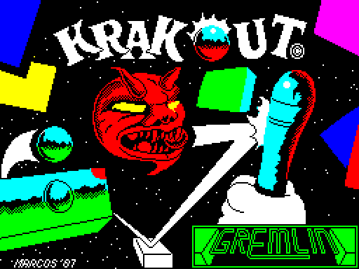

# Krakout Disassembly

This project reverse engineers [Krakout](https://spectrumcomputing.co.uk/entry/2768/ZX-Spectrum/Krakout), a game for the ZX Spectrum 48K published by Gremlin Graphics in 1987, from the original tape image using [SkoolKit](https://skoolkit.ca).

    

## Building the Disassembly

To build the HTML disassembly, install the Python packages in `tools/requirements.txt` and run `make html`. The site build is in `vendor/zx-game-disasm/`, so it needs nothing else. The build downloads the Krakout and Krakout II tape images from Spectrum Computing.

`make` and the other development targets also need the [`zx-game-disasm`](https://github.com/morozov/zx-spectrum-skills/tree/main/zx-game-disasm) skill and its requirements. If the skill is not in `~/.agents/skills/zx-game-disasm`, run `make SKILL=<path to the skill>`.

The HTML disassembly is written to `build/html/krakout/`, and the assembly source to `build/krakout.asm`.
